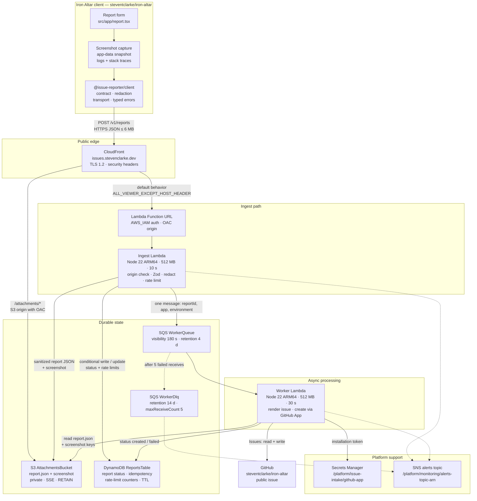
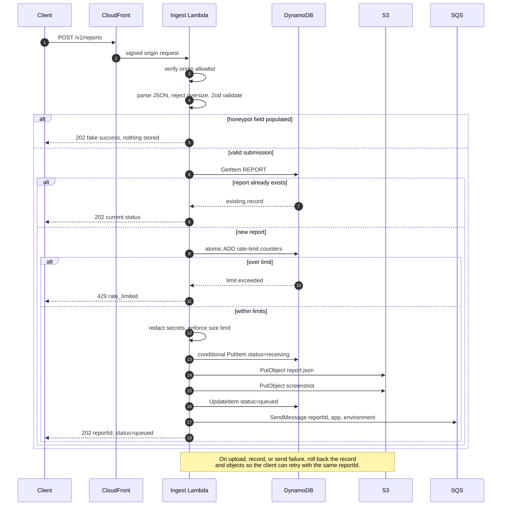
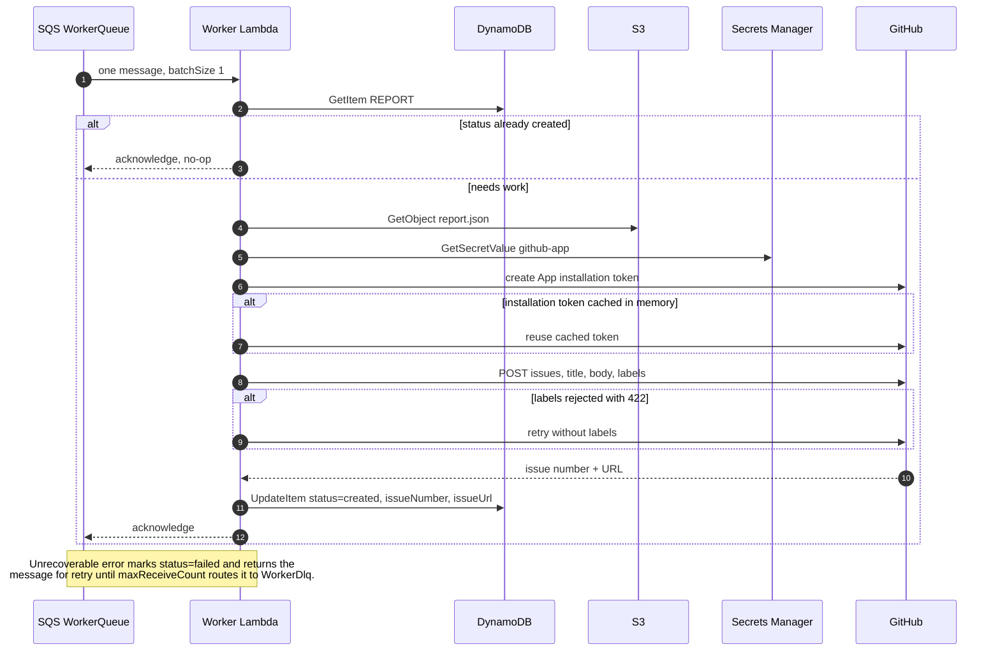
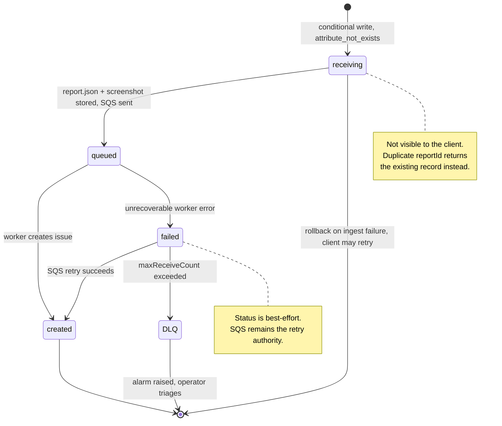

# In-App Issue Reporting — Architecture Diagrams

Rendered diagrams for [`issue-reporting-design.md`](./issue-reporting-design.md). The design
document is authoritative; these views are derived from sections 7–9.

**Legend:** solid arrows are synchronous request/response; dashed arrows are asynchronous
or side-effect writes.

---

## 1. System architecture

Deployment view across the client, the public edge, and the platform-global backend
(`IssueIntakeStack` in `issue-reporter`).

`@issue-reporter/client` is published from the `issue-reporter` repository and re-exports
the shared contract and redaction from `@issue-reporter/core`; see design §6.7 and §8.12.

**Public read path.** The issue body links `https://issues.stevenclarke.dev/attachments/...`,
which CloudFront serves directly from S3 through OAC without invoking Lambda.

---

## 2. Ingest sequence

Synchronous request path. The client only receives `202` after the report record, S3 objects,
and SQS message are in place.

---

## 3. Worker sequence

Asynchronous issue creation with idempotent retries.

---

## 4. Report lifecycle

---

## 5. Trust boundaries and durability

| Boundary                  | Control                                                                            |
| ------------------------- | ---------------------------------------------------------------------------------- |
| Client → CloudFront       | Public HTTPS; origin allowlist; honeypot; payload and rate limits                  |
| CloudFront → Function URL | `AWS_IAM` auth with OAC; Function URL is not publicly invokable                    |
| Ingest → S3               | Private bucket, public access blocked, TLS enforced, least-privilege role          |
| Worker → GitHub           | GitHub App installation scoped to `Issues: RW` and `Metadata: R` on one repository |
| Logs                      | Structured JSON with `reportId`, `app`, `status`; never raw report content         |

Where a report can be lost:

| Hop             | Guarantee                                                                                            |
| --------------- | ---------------------------------------------------------------------------------------------------- |
| Device → ingest | At-most-once. No offline queue in v1; the form persists and manual retry reuses the same `reportId`. |
| Ingest → SQS    | At-least-once once `SendMessage` succeeds. Ingest returns `202` only after the send.                 |
| SQS → worker    | At-least-once with idempotent consumer (`status = created` short-circuits) and DLQ after 5 receives. |
| Worker → GitHub | At-least-once attempt; duplicate suppression relies on the DynamoDB status check, not GitHub dedupe. |

SQS therefore protects the post-ingest hop. A request that never reaches a successful
`SendMessage` is still the client's responsibility to retry; see open question in
`issue-reporting-design.md` §8.4 regarding the outbox/rollback ordering.
